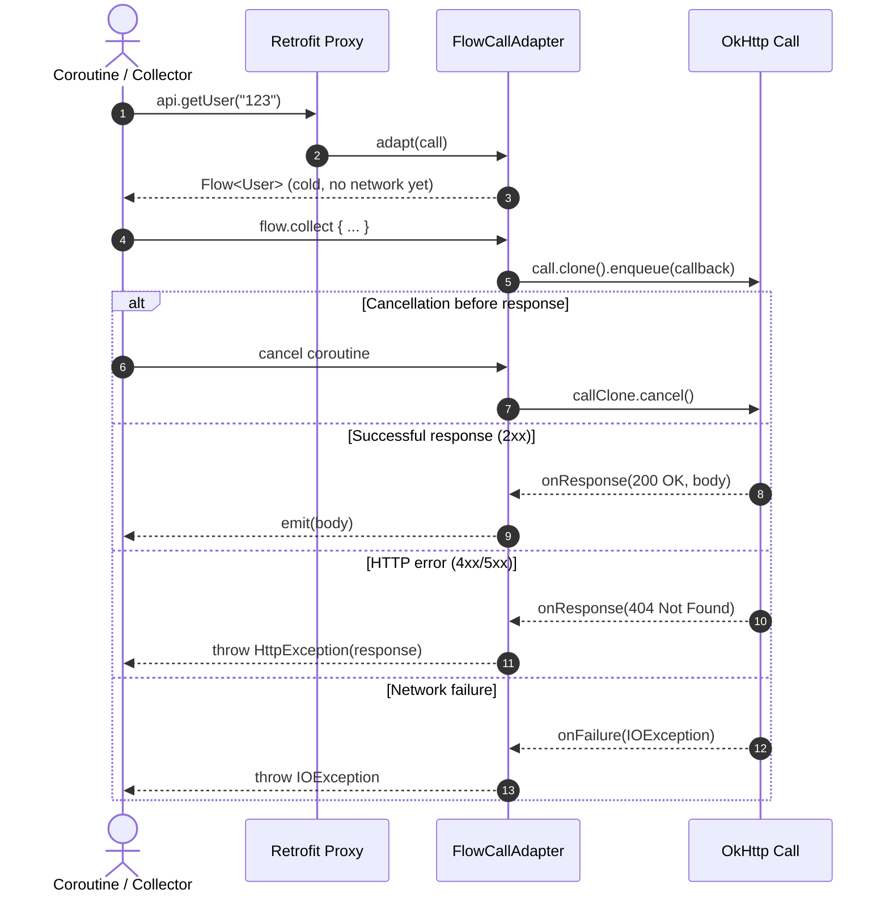

# План реализации CallAdapter.Factory для Kotlin Flow<T> (`:retrofit-adapters:flow`)

## Описание цели
Реализовать поддержку `kotlinx.coroutines.flow.Flow<T>` в качестве возвращаемого типа при объявлении методов в интерфейсах Retrofit API:
```kotlin
interface MyApiService {
  @GET("/users")
  fun getUsers(): Flow<List<User>>

  @GET("/user/{id}")
  fun getUser(@Path("id") id: String): Flow<Response<User>>

  @DELETE("/user/{id}")
  fun deleteUser(@Path("id") id: String): Flow<Unit>
}
```

Модуль будет выделен в отдельный проект `:retrofit-adapters:flow` согласно архитектуре адаптеров Retrofit (`guava`, `java8`, `rxjava`, `scala`), сохраняя чистоту ядра `:retrofit` без обязательных рантайм-зависимостей на корутины.

---

## Архитектура и принципы работы

### 1. Семантика Cold Stream (холодного потока)
- Вызов метода API `api.getUsers()` не должен выполнять сетевой запрос немедленно.
- Запрос стартует только при терминальной операции (`flow.collect { ... }`, `flow.first()`, `flow.toList()` и т.д.).
- Каждая новая подписка (коллекция) выполняет независимый запрос через `call.clone()`.
- При отмене корутины (`job.cancel()`, таймауты `withTimeout`) OkHttp-вызов немедленно отменяется (`call.cancel()`).

### 2. Поддерживаемые типы возвращаемых значений
- `Flow<T>` — при HTTP 2xx эмитит распарсенное тело ответа `T`. При HTTP non-2xx выбрасывает `retrofit2.HttpException(response)`. При сетевой ошибке выбрасывает `IOException`.
- `Flow<Response<T>>` — эмитит `Response<T>` для всех HTTP-ответов (как 2xx, так и ошибочных статус-кодов). При сетевой ошибке выбрасывает `IOException`.
- `Flow<Unit>` / `Flow<Void>` — корректно обрабатывает пустые успешные ответы (HTTP 204 No Content или пустое тело).
- `Flow<T?>` — эмитит `null`, если тело ответа пустое.

### 3. Диаграмма выполнения



---

## User Review Required

> [!IMPORTANT]
> 1. Согласно правилам проекта `AGENTS.md`, каждый новый класс (Java/Kotlin) будет помечен комментарием:
>    ```kotlin
>    // Developed by BROgrammer
>    ```
> 2. Совместимость байткода: Java 1.8 (`jvmTarget = '1.8'`), совместимость с Android API Level 21+.
> 3. Использование зависимости `libs.kotlinx.coroutines` (`1.11.0`), уже объявленной в `gradle/libs.versions.toml`.

---

## Open Questions
Все ключевые решения согласованы: модуль размещается в `:retrofit-adapters:flow`.

---

## Предлагаемые изменения

### Модуль `retrofit-adapters:flow`

#### [MODIFY] [settings.gradle](settings.gradle)
- Добавить `include ':retrofit-adapters:flow'`.

#### [NEW] [retrofit-adapters/flow/build.gradle](../retrofit-adapters/flow/build.gradle)
- Настройка Kotlin JVM плагина (`org.jetbrains.kotlin.jvm`), `com.vanniktech.maven.publish`, `org.jetbrains.dokka`.
- Зависимости:
  ```groovy
  dependencies {
    api projects.retrofit
    api libs.kotlinx.coroutines

    testImplementation libs.junit
    testImplementation libs.truth
    testImplementation libs.okhttp.mockwebserver
  }

  jar {
    manifest {
      attributes 'Automatic-Module-Name': 'retrofit2.adapter.flow'
    }
  }
  ```

#### [NEW] [retrofit-adapters/flow/README.md](../retrofit-adapters/flow/README.md)
- Документация модуля с примерами использования `FlowCallAdapterFactory.create()`.

#### [NEW] [retrofit-adapters/flow/src/main/resources/META-INF/proguard/retrofit2-flow-adapter.pro](../retrofit-adapters/flow/src/main/resources/META-INF/proguard/retrofit2-flow-adapter.pro)
- Proguard/R8 правила для библиотеки.

#### [NEW] [retrofit-adapters/flow/src/main/java/retrofit2/adapter/flow/FlowCallAdapterFactory.kt](../retrofit-adapters/flow/src/main/java/retrofit2/adapter/flow/FlowCallAdapterFactory.kt)
- Реализация `FlowCallAdapterFactory : CallAdapter.Factory()`:
  - Метод `get(returnType, annotations, retrofit)`:
    - Проверка, является ли `getRawType(returnType)` классом `Flow::class.java`. Если нет — возврат `null`.
    - Валидация `returnType is ParameterizedType` (иначе ошибка `"Flow return type must be parameterized as Flow<Foo> or Flow<? extends Foo>"`).
    - Извлечение типа элемента `observableType = getParameterUpperBound(0, returnType)`.
    - Определение обёртки: `Response<T>` vs чистый body `T`.
    - Валидация параметризации для `Response`: `"Response must be parameterized as Response<Foo> or Response<? extends Foo>"`.
    - Создание `FlowCallAdapter`:
      - `BodyCallAdapter<T>`: эмитит `T`, выбрасывает `HttpException` на ошибки, проверяет null-безопасность.
      - `ResponseCallAdapter<T>`: эмитит `Response<T>`.
  - Статический фабричный метод `FlowCallAdapterFactory.create()`.
  - Маркировка комментарием `// Developed by BROgrammer`.

#### [NEW] [retrofit-adapters/flow/src/test/java/retrofit2/adapter/flow/FlowCallAdapterFactoryTest.kt](../retrofit-adapters/flow/src/test/java/retrofit2/adapter/flow/FlowCallAdapterFactoryTest.kt)
- Полный набор модульных и интеграционных тестов с `MockWebServer`:
  1. **Success Body**: успешный ответ 200 OK возвращает ожидаемые данные в `Flow<String>`.
  2. **HTTP 404 / 500 Error**: выбрасывает `HttpException` с правильным кодом ошибки при сборе `Flow<String>`.
  3. **Network Failure**: выбрасывает `IOException` при сбоях сети/отключении сокета.
  4. **Response Wrapper**: успешный ответ и 404 корректно эмитится в `Flow<Response<String>>`.
  5. **Empty / Unit**: методы с `Flow<Unit>` и кодом 204 No Content эмитируют `Unit`.
  6. **Nullable Body**: методы с `Flow<String?>` корректно обрабатывают null.
  7. **Cold Stream**: вызов сервисного метода не инициирует HTTP запрос; повторный `collect` отправляет повторный запрос (`call.clone()`).
  8. **Cancellation**: отмена корутины (`job.cancel()`) отменяет лежащий в основе OkHttp `Call`.
  9. **Validation**: непараметризованный `Flow` или непараметризованный `Response` выбрасывают соответствующие исключения при конфигурации сервиса.

---

## План верификации

### Автоматизированные тесты
Выполнить сборку и запуск тестов с JDK 25:
```powershell
$env:JAVA_HOME="C:\Program Files\Android\Android Studio2\jbr"
.\gradlew.bat :retrofit-adapters:flow:test
```

### Форматирование и статический анализ
```powershell
$env:JAVA_HOME="C:\Program Files\Android\Android Studio2\jbr"
.\gradlew.bat spotlessApply
.\gradlew.bat :retrofit-adapters:flow:check
```

### Регрессионное тестирование
Прогнать тесты остальных связанных модулей:
```powershell
$env:JAVA_HOME="C:\Program Files\Android\Android Studio2\jbr"
.\gradlew.bat :retrofit:test :retrofit:kotlin-test:test
```
