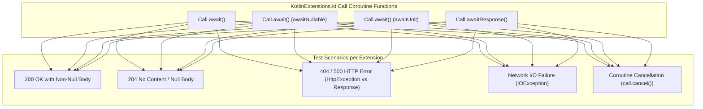

# Implementation Plan: Coroutine Test Suite for KotlinExtensionsTest

## Goal Description
Currently, `KotlinExtensionsTest.kt` in `retrofit/kotlin-test` contains only a single test method: `reifiedCreate()`.
However, `retrofit2.KotlinExtensions.kt` defines several critical coroutine extension functions on Retrofit's `Call`:
- `suspend fun <T : Any> Call<T>.await(): T`
- `suspend fun <T : Any> Call<T?>.await(): T?` (`@JvmName("awaitNullable")`)
- `suspend fun Call<Unit>.await()` (`@JvmName("awaitUnit")`)
- `suspend fun <T> Call<T>.awaitResponse(): Response<T>`

The goal is to expand [KotlinExtensionsTest.kt](../retrofit/kotlin-test/src/test/java/retrofit2/KotlinExtensionsTest.kt) with exhaustive test coverage covering every branch, conditional inspection, and execution path of these coroutine extensions in compliance with rule 7 ("Exhaustive Branch & Polymorphic Input Test Coverage") and rule 6 ("Mandatory Class Attribution for AI Agents") in [AGENTS.md](AGENTS.md).

---

## User Review Required
> [!NOTE]
> Gradle execution on this environment requires JDK 21+ for compilation due to ErrorProne dependencies. We will invoke Gradle with `JAVA_HOME="C:\Program Files\Android\Android Studio2\jbr"` (OpenJDK 25) during test verification.

> [!IMPORTANT]
> The internal helper `Throwable.suspendAndThrow(): Nothing` is marked `internal` to the `:retrofit` module and is already tested through dynamic proxy integration in [KotlinSuspendTest.kt] (../retrofit/kotlin-test/src/test/java/retrofit2/KotlinSuspendTest.kt) (`checkedExceptionsAreNotSynchronouslyThrownForBody` and `checkedExceptionsAreNotSynchronouslyThrownForResponse`). In `KotlinExtensionsTest.kt`, we focus on testing the public coroutine extension APIs on `Call`.

---

## Open Questions
None. The behavior and requirements of Retrofit's coroutine extensions are strictly specified by [KotlinExtensions.kt](../retrofit/src/main/java/retrofit2/KotlinExtensions.kt).

---

## Proposed Changes

### Core Test Suite (`retrofit:kotlin-test`)

#### [MODIFY] [KotlinExtensionsTest.kt](../retrofit/kotlin-test/src/test/java/retrofit2/KotlinExtensionsTest.kt)
Add service interfaces and test cases covering all 4 coroutine extension functions across all possible outcomes:



Detailed test cases to implement:

1. **`Call<T : Any>.await()`**:
   - `awaitReturnsBody()`: 200 OK with string body returns body value.
   - `awaitThrowsOnNullBody()`: 204 No Content response throws `KotlinNullPointerException` with explicit message `"Response from retrofit2.KotlinExtensionsTest$Service.body was null but response body type was declared as non-null"`.
   - `awaitThrowsHttpException()`: 404 Not Found response throws `HttpException` containing response code and error body.
   - `awaitThrowsHttpException500()`: 500 Internal Server Error throws `HttpException`.
   - `awaitThrowsIoException()`: Socket policy `DISCONNECT_AFTER_REQUEST` throws `IOException`.
   - `awaitCancellationWorks()`: Cancelling the awaiting coroutine invokes `continuation.invokeOnCancellation` and cancels both the Retrofit `Call` and the underlying OkHttp `Call`.
   - `awaitThrowsNullPointerExceptionWhenInvocationMissing()`: When a custom `Call` without `Invocation` tag returns null body, throws `NullPointerException`.

2. **`Call<T?>.await()` (`awaitNullable`)**:
   - `awaitNullableReturnsBody()`: 200 OK with non-null body returns body value.
   - `awaitNullableReturnsNull()`: 204 No Content returns `null` without throwing exception.
   - `awaitNullableThrowsHttpException()`: 404 Not Found throws `HttpException`.
   - `awaitNullableThrowsIoException()`: Network disconnect throws `IOException`.
   - `awaitNullableCancellationWorks()`: Cancelling the awaiting coroutine cancels the Call.

3. **`Call<Unit>.await()` (`awaitUnit`)**:
   - `awaitUnitSuccess()`: 200 OK completes returning `Unit`.
   - `awaitUnit204Success()`: 204 No Content completes returning `Unit`.
   - `awaitUnitThrowsHttpException()`: 404 Not Found throws `HttpException`.
   - `awaitUnitThrowsIoException()`: Network disconnect throws `IOException`.
   - `awaitUnitCancellationWorks()`: Cancelling the awaiting coroutine cancels the Call.

4. **`Call<T>.awaitResponse(): Response<T>`**:
   - `awaitResponseReturns200()`: 200 OK returns `Response<T>` with `isSuccessful == true`, `code() == 200`, and non-null body.
   - `awaitResponseReturns204()`: 204 No Content returns `Response<T>` with `isSuccessful == true`, `code() == 204`, and null body.
   - `awaitResponseReturns404()`: 404 Not Found returns `Response<T>` with `isSuccessful == false`, `code() == 404`, and error body (does not throw `HttpException`).
   - `awaitResponseReturns500()`: 500 Server Error returns `Response<T>` with `isSuccessful == false`, `code() == 500`.
   - `awaitResponseThrowsIoException()`: Network failure throws `IOException`.
   - `awaitResponseCancellationWorks()`: Cancelling the awaiting coroutine cancels the Call.

All new interfaces and classes will be annotated with `// Developed by BROgrammer` according to rule 6.

---

## Verification Plan

### Automated Tests
1. Run spotless check & apply:
   ```powershell
   $env:JAVA_HOME="C:\Program Files\Android\Android Studio2\jbr"; .\gradlew.bat spotlessApply
   ```
2. Run targeted test suite:
   ```powershell
   $env:JAVA_HOME="C:\Program Files\Android\Android Studio2\jbr"; .\gradlew.bat :retrofit:kotlin-test:test --tests "retrofit2.KotlinExtensionsTest"
   ```
3. Run all tests in `:retrofit:kotlin-test`:
   ```powershell
   $env:JAVA_HOME="C:\Program Files\Android\Android Studio2\jbr"; .\gradlew.bat :retrofit:kotlin-test:test
   ```
4. Verify code formatting and linting:
   ```powershell
   $env:JAVA_HOME="C:\Program Files\Android\Android Studio2\jbr"; .\gradlew.bat spotlessCheck
   ```

### Manual Verification
- Inspect the test output report in `retrofit/kotlin-test/build/reports/tests/test/index.html` to confirm all 23+ test cases pass and properly exercise each extension method.
