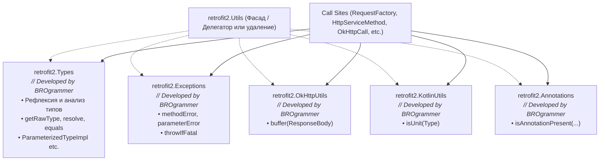

# План рефакторинга класса `retrofit2.Utils`

## 1. Цель и контекст

Класс [`Utils`](../retrofit/src/main/java/retrofit2/Utils.java) в модуле `retrofit` в настоящее время представляет собой монолитный утилитный класс объемом ~560 строк, объединяющий несколько слабо связанных обязанностей:
1. Рефлексия обобщенных типов (Generics), разрешение типов и реализация интерфейсов `ParameterizedType`, `GenericArrayType`, `WildcardType`.
2. Фабрика форматированных исключений (`methodError`, `parameterError`) при валидации аннотаций методов и параметров сервисов.
3. Обработка фатальных исключений виртуальной машины (`throwIfFatal`).
4. Буферизация OkHttp `ResponseBody` (`buffer`).
5. Проверка наличия аннотаций в массиве (`isAnnotationPresent`).
6. Динамическое определение Kotlin `Unit` без жесткой зависимости от Kotlin runtime (`isUnit`).

Класс `Utils` является пакетно-приватным (`final class Utils`). Ни один публичный API Retrofit и ни один внешний модуль не выставляет его наружу.

Цель рефакторинга — разделить `Utils` на специализированные пакетно-приватные классы с единственной зоной ответственности (Single Responsibility Principle), сохранив 100% обратную совместимость, строго соблюдая все требования и ограничения из [AGENTS.md](file:///AGENTS.md).

---

## 2. Архитектурная декомпозиция

Все новые классы создаются в пакете `retrofit2` с модификатором доступа по умолчанию (package-private).



### 2.1. Класс `retrofit2.Types`
- **Атрибуция**: `// Developed by BROgrammer`
- **Область видимости**: `final class Types` (package-private, неинстанцируемый с `private Types() {}`)
- **Зона ответственности**: манипуляции с обобщенными типами (`java.lang.reflect.Type`), поиск супертипов, извлечение границ параметров, проверка на примитивы/неразрешимые типы.
- **Методы и константы**:
  - `static final Type[] EMPTY_TYPE_ARRAY`
  - `static Class<?> getRawType(Type type)`
  - `static boolean equals(Type a, Type b)`
  - `static Type getGenericSupertype(Type context, Class<?> rawType, Class<?> toResolve)`
  - `static String typeToString(Type type)` *(строго без вызова `Type.getTypeName()`, сохраняя проверку `type instanceof Class ? ((Class<?>) type).getName() : type.toString()` для поддержки Android 21)*
  - `static Type getSupertype(Type context, Class<?> contextRawType, Class<?> supertype)`
  - `static Type resolve(Type context, Class<?> contextRawType, Type toResolve)`
  - `static void checkNotPrimitive(Type type)`
  - `static Type getParameterUpperBound(int index, ParameterizedType type)`
  - `static Type getParameterLowerBound(int index, ParameterizedType type)`
  - `static boolean hasUnresolvableType(@Nullable Type type)`
  - Вспомогательные приватные методы: `indexOf`, `resolveTypeVariable`, `declaringClassOf`.
- **Вложенные реализации типов**:
  - `static final class ParameterizedTypeImpl implements ParameterizedType`
  - `static final class GenericArrayTypeImpl implements GenericArrayType`
  - `static final class WildcardTypeImpl implements WildcardType`
  *(Все переопределяющие методы снабжаются аннотацией `@Override` для соблюдения ErrorProne rule `MissingOverride`).*

### 2.2. Класс `retrofit2.Exceptions`
- **Атрибуция**: `// Developed by BROgrammer`
- **Область видимости**: `final class Exceptions` (package-private, неинстанцируемый)
- **Зона ответственности**: форматирование информативных ошибок валидации методов/параметров API интерфейсов и обработка неустранимых сбоев виртуальной машины.
- **Методы**:
  - `static RuntimeException methodError(Method method, String message, Object... args)`
  - `@SuppressWarnings("AnnotateFormatMethod") static RuntimeException methodError(Method method, @Nullable Throwable cause, String message, Object... args)`
  - `static RuntimeException parameterError(Method method, Throwable cause, int p, String message, Object... args)`
  - `static RuntimeException parameterError(Method method, int p, String message, Object... args)`
  - `@SuppressWarnings("removal") static void throwIfFatal(Throwable t)` *(проверка `VirtualMachineError`, `ThreadDeath`, `LinkageError`)*

### 2.3. Класс `retrofit2.OkHttpUtils`
- **Атрибуция**: `// Developed by BROgrammer`
- **Область видимости**: `final class OkHttpUtils` (package-private, неинстанцируемый)
- **Зона ответственности**: вспомогательные операции над типами библиотеки OkHttp (`ResponseBody`).
- **Методы**:
  - `static ResponseBody buffer(final ResponseBody body) throws IOException`

### 2.4. Класс `retrofit2.KotlinUtils`
- **Атрибуция**: `// Developed by BROgrammer`
- **Область видимости**: `final class KotlinUtils` (package-private, неинстанцируемый)
- **Зона ответственности**: безопасное взаимодействие с Kotlin runtime (определение `kotlin.Unit`), исключающее сбои `NoClassDefFoundError` в чистых Java-окружениях.
- **Методы и поля**:
  - `private static boolean checkForKotlinUnit = true;`
  - `static boolean isUnit(Type type)`

### 2.5. Класс `retrofit2.Annotations`
- **Атрибуция**: `// Developed by BROgrammer`
- **Область видимости**: `final class Annotations` (package-private, неинстанцируемый)
- **Зона ответственности**: поиск и анализ аннотаций в массивах.
- **Методы**:
  - `static boolean isAnnotationPresent(Annotation[] annotations, Class<? extends Annotation> cls)`

### 2.6. Судьба класса `retrofit2.Utils`
- **Рекомендуемый подход (Facade & Delegation)**:
  - Сохранить класс `Utils` как пакетно-приватный фасад, делегирующий вызовы новым классам (`Types`, `Exceptions`, `OkHttpUtils`, `KotlinUtils`, `Annotations`).
  - Класс `Utils.ParameterizedTypeImpl` может быть алиасом (или подклассом/делегатом) `Types.ParameterizedTypeImpl`.
  - Все прямые вызовы в коде Retrofit переключаются на новые специализированные классы.
  - Это исключает любые регрессии и обеспечивает плавный рефакторинг.
- **Альтернативный подход (Полное удаление)**:
  - Удалить `Utils.java` полностью после перевода всех вызовов на новые классы.

---

## 3. Обновление мест вызова (Call Sites)

В рамках рефакторинга вызовы внутри модуля `retrofit` обновляются на специализированные классы:

1. [`retrofit2.HttpServiceMethod`](file:///retrofit/src/main/java/retrofit2/HttpServiceMethod.java):
   - Замена `Utils.getRawType(...)` $\rightarrow$ `Types.getRawType(...)`
   - Замена `Utils.methodError(...)` $\rightarrow$ `Exceptions.methodError(...)`
   - Замена `Utils.isUnit(...)` $\rightarrow$ `KotlinUtils.isUnit(...)`
   - Замена `new Utils.ParameterizedTypeImpl(...)` $\rightarrow$ `new Types.ParameterizedTypeImpl(...)`
2. [`retrofit2.OkHttpCall`](file:///retrofit/src/main/java/retrofit2/OkHttpCall.java):
   - Замена `Utils.throwIfFatal(...)` $\rightarrow$ `Exceptions.throwIfFatal(...)`
   - Замена `Utils.buffer(...)` $\rightarrow$ `OkHttpUtils.buffer(...)`
3. [`retrofit2.ParameterHandler`](file:///retrofit/src/main/java/retrofit2/ParameterHandler.java):
   - Замена `Utils.parameterError(...)` $\rightarrow$ `Exceptions.parameterError(...)`
4. [`retrofit2.RequestFactory`](file:///retrofit/src/main/java/retrofit2/RequestFactory.java):
   - Замена `Utils.methodError(...)` $\rightarrow$ `Exceptions.methodError(...)`
   - Замена `Utils.parameterError(...)` $\rightarrow$ `Exceptions.parameterError(...)`
   - Замена `Utils.getRawType(...)` $\rightarrow$ `Types.getRawType(...)`
   - Замена `Utils.getParameterUpperBound(...)` $\rightarrow$ `Types.getParameterUpperBound(...)`
   - Замена `Utils.getSupertype(...)` $\rightarrow$ `Types.getSupertype(...)`
   - Замена `Utils.hasUnresolvableType(...)` $\rightarrow$ `Types.hasUnresolvableType(...)`
5. [`retrofit2.ServiceMethod`](file:///retrofit/src/main/java/retrofit2/ServiceMethod.java):
   - Замена `Utils.methodError(...)` $\rightarrow$ `Exceptions.methodError(...)`
   - Замена `Utils.hasUnresolvableType(...)` $\rightarrow$ `Types.hasUnresolvableType(...)`
6. [`retrofit2.SkipCallbackExecutorImpl`](file:///retrofit/src/main/java/retrofit2/SkipCallbackExecutorImpl.java):
   - Замена `Utils.isAnnotationPresent(...)` $\rightarrow$ `Annotations.isAnnotationPresent(...)`

---

## 4. Строгое соблюдение правил проекта (AGENTS.md)

При реализации будут строго соблюдены следующие требования:

| Требование | Правило | Реализация в рамках рефакторинга |
| :--- | :--- | :--- |
| **Атрибуция ИИ** | Правило 6 | Перед объявлением каждого нового класса (`Types`, `Exceptions`, `OkHttpUtils`, `KotlinUtils`, `Annotations`, а также новых тестовых классов) добавляется комментарий `// Developed by BROgrammer`. |
| **Java 8 / Android 21 API** | Правило 2 | Использовать только API Java 8, доступные на Android API 21 (Lollipop 5.0). Категорически запрещено использовать `Type.getTypeName()` или Kotlin `type.typeName` (вызывают `NoSuchMethodError` на Android 21), `Method.isDefault()`, `java.time.*`, `Stream`, `Optional`, `List.of()`, `Map.of()`. |
| **Animal Sniffer** | Правило 2 | Сигнатуры автоматически валидируются против `org.codehaus.mojo.signature:java18` и `android-api-level-21:5.0.1_r2` через `./gradlew animalsnifferMain`. |
| **ErrorProne Static Analysis** | Правило 4 | Никаких wildcard imports (`import foo.bar.*`), обязательный `@Override` на всех методах интерфейсов (`ParameterizedType`, `GenericArrayType`, `WildcardType`), отсутствие неиспользуемых переменных, полей и импортов. |
| **Форматирование Spotless** | Правило 3 | Все файлы Java форматируются утилитой `google-java-format` (2 пробела, без wildcard imports) через `./gradlew spotlessApply`. |
| **Зависимости** | Правило 5 | Никаких правок в `gradle/libs.versions.toml`, никаких новых библиотек. |
| **Ветвление Git** | Правило 1 | Базовой веткой является `trunk`. |

---

## 5. План тестирования и валидации

### 5.1. Новые модульные тесты в `retrofit/java-test`
Ранее класс `Utils` не имел собственного изолированного теста `UtilsTest` и проверялся косвенно через интеграционные тесты. В рамках рефакторинга будут добавлены целевые тесты с атрибуцией `// Developed by BROgrammer`:
- [`retrofit2.TypesTest`](file:///retrofit/java-test/src/test/java/retrofit2/TypesTest.java):
  - Тестирование `getRawType` для примитивов, классов, массивов, generic-типов и wildcard-типов.
  - Тестирование `equals` для `ParameterizedTypeImpl`, `GenericArrayTypeImpl`, `WildcardTypeImpl`.
  - Тестирование `resolve` и `getSupertype` для вложенных generic-иерархий.
  - Тестирование `getParameterUpperBound` и `getParameterLowerBound`.
  - Тестирование `hasUnresolvableType` на TypeVariable и WildcardType.
- [`retrofit2.ExceptionsTest`](file:///retrofit/java-test/src/test/java/retrofit2/ExceptionsTest.java):
  - Тестирование `methodError` и `parameterError` с форматированием сообщений и проверкой причин (`cause`).
  - Тестирование `throwIfFatal` для `OutOfMemoryError`, `StackOverflowError`, `ThreadDeath` и пользовательских исключений.
- [`retrofit2.OkHttpUtilsTest`](file:///retrofit/java-test/src/test/java/retrofit2/OkHttpUtilsTest.java):
  - Тестирование `buffer` для пустого и наполненного `ResponseBody`, проверка сохранения Content-Type и Content-Length.
- [`retrofit2.KotlinUtilsTest`](file:///retrofit/java-test/src/test/java/retrofit2/KotlinUtilsTest.java):
  - Тестирование `isUnit` для `kotlin.Unit.class`, `void.class`, `Void.class`, `String.class`.
- [`retrofit2.AnnotationsTest`](file:///retrofit/java-test/src/test/java/retrofit2/AnnotationsTest.java):
  - Тестирование `isAnnotationPresent` на массивах аннотаций.

### 5.2. Поэтапный протокол верификации
1. **Компиляция с проверками ErrorProne**:
   ```powershell
   $env:JAVA_HOME="C:\Users\rusgo\.gradle\jdks\azul_systems__inc_-25-amd64-windows.2"; .\gradlew.bat :retrofit:compileJava :retrofit:compileExtraJava
   ```
2. **Запуск модульных тестов на JDK 8, 11, 17, 25**:
   ```powershell
   $env:JAVA_HOME="C:\Users\rusgo\.gradle\jdks\azul_systems__inc_-25-amd64-windows.2"; .\gradlew.bat :retrofit:java-test:test
   ```
3. **Проверка совместимости сигнатур (Animal Sniffer: Java 8 + Android API 21)**:
   ```powershell
   $env:JAVA_HOME="C:\Users\rusgo\.gradle\jdks\azul_systems__inc_-25-amd64-windows.2"; .\gradlew.bat :retrofit:animalsnifferMain
   ```
4. **Форматирование Spotless**:
   ```powershell
   $env:JAVA_HOME="C:\Users\rusgo\.gradle\jdks\azul_systems__inc_-25-amd64-windows.2"; .\gradlew.bat spotlessApply
   $env:JAVA_HOME="C:\Users\rusgo\.gradle\jdks\azul_systems__inc_-25-amd64-windows.2"; .\gradlew.bat spotlessCheck
   ```
5. **Полный прогон проверок модуля**:
   ```powershell
   $env:JAVA_HOME="C:\Users\rusgo\.gradle\jdks\azul_systems__inc_-25-amd64-windows.2"; .\gradlew.bat :retrofit:check
   ```
